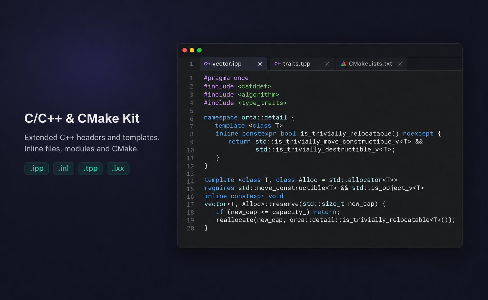

# C/C++ & CMake Kit for Orca

[](https://github.com/be0hhh/orca-cpp-kit/releases)
[](LICENSE)



Syntax highlighting for C++ implementation headers, C++ module units, CMake scripts, and CMake cache files. This is a content-only plugin: it adds TextMate grammars and editor settings, with no background process or compiler integration.

## Supported files

| Files | Highlighting |
| --- | --- |
| `.ipp`, `.inl`, `.tpp`, `.tcc`, `.ixx`, `.cppm` | C++ inline/template implementations and module units |
| `CMakeLists.txt`, `.cmake` | CMake scripts |
| `CMakeCache.txt` | Cache keys, types, values, and help comments |

Ordinary `.cpp`, `.cc`, `.hpp`, and other built-in C++ associations remain with Orca's native support.

The C++ grammar uses the keyword, identifier, delimiter, number, string, comment, and annotation categories used by Monaco 0.55.1 C++. Standard library names and function names retain native identifier coloring. Modern keywords include `module`, `import`, `concept`, `requires`, `consteval`, and coroutine keywords. Numeric suffixes, digit separators, hexadecimal floats, prefixed raw strings, and complete multi-character operators are recognized. Colors come from the active Orca theme; TextMate and Monaco have different tokenization engines, so this is category alignment rather than a promise of identical parsing in every case.

CMake highlighting covers command calls, quoted and bracket arguments, bracket comments, recursive variable expansions (`${PREFIX_${NAME}}`), environment/cache variables, and nested generator expressions. Cache entries use a separate grammar rather than being interpreted as scripts.

This plugin does not provide semantic analysis, completion, debugging, build commands, or error diagnostics.

## Install and try

In Orca **Settings → Plugins**, install from this Git URL:

```text
https://github.com/be0hhh/orca-cpp-kit
```

On the plugin page, the **Create** actions for **C++ template example**, **C++ module example**, and **CMake script example** open populated files in the active workspace. The same entries are available from the tab bar's **+** menu. The post-install **Try it** action uses the first example.

Orca's existing **Try it** buttons beside individual syntax contributions open empty files for typing. The host does not automatically load the `samples/` directory for those buttons.

Examples are in [samples](samples). `example.cmake` is a runnable script (`cmake -P samples/example.cmake`); `CMakeLists.txt` is a highlighting fixture with illustrative target paths, not a complete project. `CMakeCache.txt` is sample data.

## Development

```sh
npm ci
npm test
orca plugin validate . --json
```

Tests run the grammars with TextMate and Oniguruma. They compare C++ keyword classifications and editor configuration with pinned Monaco 0.55.1, execute its actual Monarch tokenizer for include/attribute parity regressions, and exercise complete operators, numeric suffixes, multiline raw strings/comments, nested CMake expressions, cache entries, and populated examples. Development dependencies are not required to use the plugin.

## License

MIT. See [LICENSE](LICENSE) and [third-party notices](THIRD_PARTY_NOTICES.md).
